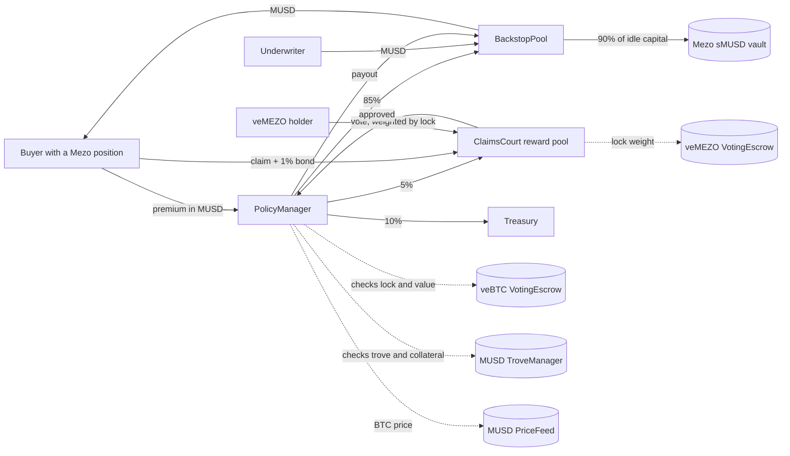

# BACKSTOP

**Insurance for Mezo positions, paid in MUSD.** Underwriters earn premiums on top of the MUSD savings rate. If a
contract you use is exploited, or Mezo stops processing transactions, your claim is decided by veMEZO holders and paid
from the pool.

**Live app:** https://backstop-pearl.vercel.app · **Network:** Mezo testnet (chain 31611) · **Track:** 1 (DeFi), also fits 2

| Contract | Address (Mezo testnet) | Source |
|---|---|---|
| BackstopPool | [`0xf8F5D150FE8A66C10eC786F37904a9FB82638B4C`](https://explorer.test.mezo.org/address/0xf8F5D150FE8A66C10eC786F37904a9FB82638B4C) | [Sourcify exact match](https://repo.sourcify.dev/contracts/full_match/31611/0xf8F5D150FE8A66C10eC786F37904a9FB82638B4C/) |
| PolicyManager | [`0xB9DB90dE921118f1793D81242F571afd722DF05F`](https://explorer.test.mezo.org/address/0xB9DB90dE921118f1793D81242F571afd722DF05F) | [Sourcify exact match](https://repo.sourcify.dev/contracts/full_match/31611/0xB9DB90dE921118f1793D81242F571afd722DF05F/) |
| ClaimsCourt | [`0xD50CF771E2d0F192CF2100F5Dab9bE0646904a50`](https://explorer.test.mezo.org/address/0xD50CF771E2d0F192CF2100F5Dab9bE0646904a50) | [Sourcify exact match](https://repo.sourcify.dev/contracts/full_match/31611/0xD50CF771E2d0F192CF2100F5Dab9bE0646904a50/) |
| StarterKit | [`0xDE8515faffD1e41b74F0e9DDa7EF116b8219E7D6`](https://explorer.test.mezo.org/address/0xDE8515faffD1e41b74F0e9DDa7EF116b8219E7D6) | [Sourcify exact match](https://repo.sourcify.dev/contracts/full_match/31611/0xDE8515faffD1e41b74F0e9DDa7EF116b8219E7D6/) |

---

## Try it in two minutes

1. **Add Mezo testnet to your wallet** (MetaMask, Rabby or any injected wallet). The app adds it for you when you
   connect. Manual values: RPC `https://rpc.test.mezo.org`, chain id `31611`, currency `BTC`, explorer
   `https://explorer.test.mezo.org`.
2. **Get test funds.** Click **Send me a starter kit** on the [Get cover](https://backstop-pearl.vercel.app/#/cover)
   page (20 test MUSD plus gas, one per wallet), or use the official faucet at https://faucet.test.mezo.org/ and
   borrow MUSD in the [Mezo testnet app](https://testnet.mezo.org).
3. **Buy cover.** On [Get cover](https://backstop-pearl.vercel.app/#/cover), pick *Mezo Swap (Tigris) pools exploit*,
   enter 10 MUSD for 30 days and click **Approve and buy cover**. Your policy appears under *Your policies* and in
   *Every policy sold*.
4. **Underwrite.** On [Underwrite](https://backstop-pearl.vercel.app/#/underwrite), deposit MUSD. 90% of it lands in
   Mezo's sMUSD savings vault immediately. Request a withdrawal and watch the one-hour testnet cooldown count down.
5. **Watch the court.** [Claims court](https://backstop-pearl.vercel.app/#/claims) shows an approved claim and a
   rejected claim, each with its evidence, veMEZO votes and reward pot. If you hold a veMEZO lock on testnet, you can
   vote on open claims.
6. **See the data.** [Oct 5 replay](https://backstop-pearl.vercel.app/#/replay) and
   [Proof](https://backstop-pearl.vercel.app/#/proof) list every number's on-chain source.

### Run the tests

```sh
git clone --recurse-submodules https://github.com/egbujor-emmanuel/backstop
cd backstop/contracts
forge test --no-match-path "test/fork/*"                                       # 100 unit/fuzz tests + 6 invariants
forge test --match-contract MezoTestnetForkTest --fork-url https://rpc.test.mezo.org -vv                      # full lifecycle on Mezo testnet's real contracts
forge test --match-contract MezoMainnetForkTest --fork-url https://mainnet.mezo.public.validationcloud.io -vv  # the same lifecycle on Mezo MAINNET's real contracts (local fork, no funds move)
```

### Reproduce the mainnet data

```sh
cd backtest
python tx_liveness.py https://mainnet.mezo.public.validationcloud.io 2026-10-06T06:00:00 2026-10-06T18:00:00 15 out.json
```

### Run the app locally

```sh
cd app && npm ci && npm run dev
```

---

## Why this exists

On **2026-10-05 at 18:54 UTC** an attacker exploited the veBTC contract and drained **37 locked positions (5.52 BTC)**
from 36 holders in twelve minutes. At Mezo's own oracle price at that block (BTC $85,604.78, block 12,311,508), that is
**$472,476**. Mezo repaid every holder from protocol-owned funds. The next day it halted all transactions for about five
and a half hours and [wrote](https://mezo.org/blog/incident-report-october-5-2026/) that it is "investigating whether
there is a class of automated triggers that could have allowed both automated detection and automated blast
prevention."

Today the protocol's treasury is the only backstop for Mezo users. BACKSTOP turns that liability into a market: people
who want protection pay a premium, people who want yield carry the risk, and people with long-term skin in Mezo (veMEZO
holders) decide what is a valid claim.

We read all 155 Buildathon products through AKINDO's public API on 2026-11-13. No other submission sells cover against
contract exploits, chain halts or bridge failure, and none lets veMEZO holders decide claims. We also found no existing
cover protocol that covers positions on the Mezo chain. The nearest projects solve different problems:

| Project | What it protects | Who decides a payout | How BACKSTOP differs |
|---|---|---|---|
| Surety | Lenders in its own credit vault, against borrower default | Automatic loss accounting | BACKSTOP covers exploits and halts, which a loss formula cannot see. A lender in a credit vault still carries the risk of a veBTC or lending-market exploit, which BACKSTOP can cover. |
| Sellar | AI-agent payments sent to scam addresses | One reviewer | BACKSTOP is backed by outside underwriters, priced by utilisation, and decided by veMEZO holders. |
| Lifeline and the trove-rescue projects | Troves close to liquidation | An automatic trigger | They act before a price-driven liquidation. BACKSTOP pays after a protocol failure. |
| MezGuard | sMUSD savings, by exiting when danger signs appear | An automatic exit | Prevention by leaving. BACKSTOP pays for a loss that already happened. |
| Roster, Piton | BTC price moves (options) | The market | Price hedges, not cover against protocols failing. |

## How it works



| Role | What they do | What they get |
|---|---|---|
| **Buyer** | Buys a policy for a veBTC lock, a trove's collateral, Mezo Swap pools, the MEZO bridge or a transaction halt. | A payout in MUSD if a claim is approved. The policy is a non-transferable ERC-721 with an on-chain SVG. |
| **Underwriter** | Deposits MUSD into an ERC-4626 vault (bsMUSD). | 85% of premiums plus the sMUSD savings yield on 90% of idle capital. |
| **Assessor** | Votes on claims with a veMEZO lock. Weight is the lock's voting power one second before the claim was filed, read from its own on-chain checkpoint history (locked MEZO × remaining lock time ÷ 4 years; full weight for permanent locks). | A share of 5% of every premium and of the bonds of rejected claims, paid to the voters on the winning side. |

### Rules the contracts enforce

- **Cover is fully backed.** The pool refuses any policy larger than its free capital, and underwriters can never
  withdraw capital that backs an active policy.
- **No over-insurance.** Cover on a veBTC lock or a trove can never exceed that position's value at MUSD's PriceFeed,
  summed across every policy on the same position, including after the lock changes hands.
- **No just-in-time farming.** Premiums vest into the share price over 7 days, and withdrawals wait out a cooldown.
- **Votes cannot be manufactured after a claim appears.** Each lock votes once per claim, with the weight it had one
  second before filing, read from veMEZO's checkpoint history (the same maths as `balanceOfNFTAt`). Merging, splitting,
  transferring or topping up a lock after filing changes nothing, and a lock created after filing has no weight. A lock
  must also outlast the vote, so voters carry the long-term cost of a bad decision. Claimants cannot vote on their own
  claim.
- **A claim needs broad agreement.** Approval takes a supermajority of the weight cast (60% on testnet), a quorum fixed
  at filing (a floor, or a share of total veMEZO voting power that fails closed if it cannot be read) and a minimum
  number of distinct locks. A tie is a rejection.
- **Rewards cannot be farmed.** All claims on one policy together can draw at most the assessor cut that policy paid in,
  so filing and voting on your own claims cannot pull out what other buyers paid.
- **A decided claim is never lost.** If the payout cannot complete (for example while sMUSD withdrawals are paused), the
  approval stays on record and anyone can retry the payout. `finalize` must carry enough gas for the payout, so a caller
  cannot force a deferral, and a bond refund that cannot be delivered is held for the claimant instead of blocking the
  decision.
- **Prices move with risk.** Premiums rise with pool utilisation (1× empty to 5× full, averaged over the purchase), and
  `buy` reverts above the buyer's `maxPremium`, so nobody can be front-run into a worse price.
- **No admin over money.** The owner can curate products and pause new sales. It cannot move pool funds, change an
  existing policy or approve a claim. The court has no admin at all.
- **MUSD's own core is not covered.** Cover paid in MUSD cannot back a failure of MUSD itself, so the MUSD core
  contracts are excluded from every product.

### Why transaction halts go to the court

During the 2026-10-06 halt (09:27 to 15:00 UTC in Mezo's incident report), Mezo **kept producing blocks** (233 per
15 minutes, as normal) while EVM transactions fell to zero or one per 15 minutes. Between 09:30 and 15:00 only 10 EVM
transactions were included, against about 60 every 15 minutes on a normal day, and they came from three senders: one
Safe multisig call, one protocol system call from the zero address, and eight contract deployments from a single
address ([`backtest/halt_txs.py`](backtest/halt_txs.py), output in
[`backtest/oct6_halt_txs.json`](backtest/oct6_halt_txs.json)). No ordinary wallet transacted for five and a half hours.

A contract cannot see that kind of halt by watching block times, and its own heartbeat cannot land during it. So halt
claims go through the court, with [`backtest/tx_liveness.py`](backtest/tx_liveness.py) and `halt_txs.py` as the
evidence tools. This was measured before the design was finalised; an earlier block-gap detector was removed because of
it (kept for reference in `docs/removed/`).

## Mezo integration

| Mezo primitive | Address (testnet) | How BACKSTOP uses it |
|---|---|---|
| MUSD | `0x118917a40FAF1CD7a13dB0Ef56C86De7973Ac503` | Premiums, underwriting capital, bonds, payouts, assessor rewards |
| sMUSD (MUSDSavingsRate) | `0x6f461c68B2c5492C0F5CCEc5a264d692aA7A8e16` | Idle underwriting capital is deposited; yield is claimed into the pool |
| TroveManager | `0xE47c80e8c23f6B4A1aE41c34837a0599D5D16bb0` | Trove cover requires an active trove; cover capped by its collateral |
| PriceFeed | `0x86bCF0841622a5dAC14A313a15f96A95421b9366` | Values veBTC locks and troves at the price MUSD itself uses |
| veBTC | `0xB63fcCd03521Cf21907627bd7fA465C129479231` | veBTC cover checks ownership and locked BTC |
| veMEZO | `0xaCE816CA2bcc9b12C59799dcC5A959Fb9b98111b` | Claims are decided by veMEZO lock weight |

MUSD demand is created on both sides: underwriters must hold MUSD to provide cover, buyers pay premiums in MUSD, and
claimants bond in MUSD. veMEZO gets a new job: deciding claims, paid from premiums.

### Integration notes we verified on-chain (useful to other builders)

- The sMUSD address in Mezo's docs (`0xb4D4…51CC`) has **no code on testnet**; the testnet vault is `0x6f461c68…7A8e16`.
- sMUSD is **not ERC-4626**: deposits mint 1:1 and yield is pulled with `claimYield()`.
- Pyth's MUSD/USD feed on Mezo was about **110 days stale** on both networks when we checked (it is a pull oracle).
- veMEZO `balanceOfNFT` and `balanceOfNFTAt` revert on testnet; `userPointEpoch`, `userPointHistory`, `locked` and
  `totalVotingPower` work, so the court reconstructs historical weight from the checkpoints itself.
- veMEZO `depositFor` is permissionless: anyone can top up anyone's lock. A court that reads current weight can have a
  vote erased by a stranger's top-up; reading weight at `filedAt − 1` from history closes that.
- veBTC `ownerOf` returns `address(0)` for unknown ids instead of reverting.
- Two contracts on Mezo mainnet call themselves veBTC. The one in `mezo-org/tigris`
  `deployments/mainnet/VeBTC.json` (`0x7D80…5914`) holds 0.00096 BTC across 22 locks. The live veBTC is
  `0x3D4b1b884A7a1E59fE8589a3296EC8f8cBB6f279` (789 BTC, 6,179 locks): on Oct 5 its lock #826 held exactly the
  3.366676916 BTC the incident report lists as drained. BACKSTOP's first veBTC product named the stale address, so
  it was paused (its policy keeps its terms) and product #5 names the live one.
- Mainnet addresses used by the fork test, each checked on chain: MUSD `0xdD468A1DDc392dcdbEf6db6e34E89AA338F9F186`,
  sMUSD `0xb4D498029af77680cD1eF828b967f010d06C51CC` (`yieldToken()` is MUSD), PriceFeed
  `0xc5aC5A8892230E0A3e1c473881A2de7353fFcA88`, TroveManager `0x94AfB503dBca74aC3E4929BACEeDfCe19B93c193`, veMEZO
  `0xb90fdAd3DFD180458D62Cc6acedc983D78E20122` (locks MEZO, 99.8M voting power).
- Mezo's Skip BTC/USD oracle (`0x7b7c…0015`) is a native precompile: Foundry fork tests must serve its live value.

## Proof on Mezo testnet

Every wallet below is a BACKSTOP team wallet and is labelled as one in the app. The two claims are drills, labelled as
drills in their evidence documents ([DRILL-001](docs/drills/DRILL-001.md), [DRILL-002](docs/drills/DRILL-002.md)).
This is the run on the current contracts (v2.2); every row links the full transaction on the Mezo testnet explorer.

<!-- PROOF-TABLE:START -->
| # | Step | Transaction |
|---|---|---|
| 1 | trove owner adds 0.04 BTC collateral and borrows 880 MUSD from their own Mezo trove (ICR 207%) | [`0x0d0c8c4c…85e3`](https://explorer.test.mezo.org/tx/0x0d0c8c4c9e1a0c5de4a653af240ef3bea103310f6d1dbdf2a0566e6383b185e3) |
| 2 | underwriter approves pool for 900 MUSD | [`0x743f4579…44fe`](https://explorer.test.mezo.org/tx/0x743f457994602a3b4deeb0690f2ad4768aa8d0578b3690447015ddda478244fe) |
| 3 | underwriter deposits 900 MUSD (idle share parked in sMUSD) | [`0xdb8e4eb3…4776`](https://explorer.test.mezo.org/tx/0xdb8e4eb3ab86978c6edf1e35c740f3b656bb9ba57bc8346f1c20f7b1889f4776) |
| 4 | trove owner approves policy manager | [`0x7314f70a…f65a`](https://explorer.test.mezo.org/tx/0x7314f70a2297c23b5bad8cef700145957398a5705ec6c959023b0c71b338f65a) |
| 5 | trove owner insures own MUSD trove: 500 MUSD, 30 days | [`0x65049177…1984`](https://explorer.test.mezo.org/tx/0x6504917725c6e41271a3a39db3060bb2e1914daba7b556908994e3faa6ee1984) |
| 6 | buyer approves policy manager | [`0xb1732481…8345`](https://explorer.test.mezo.org/tx/0xb1732481724e3ada034b90ba2fba2c777c1093893abf79aacdf5434cec3f8345) |
| 7 | buyer approves claims court for bonds | [`0x43215dc4…3596`](https://explorer.test.mezo.org/tx/0x43215dc4feac9928df407b6cff77af2e50e677778d608747989fe38c1e083596) |
| 8 | buyer insures Tigris pools: 200 MUSD, 30 days | [`0xc350af5b…08ef`](https://explorer.test.mezo.org/tx/0xc350af5b5d54baf63d55d3448c17661453eb7cf9ff639476571db35d5b5e08ef) |
| 9 | buyer insures transaction halt: 100 MUSD, 30 days | [`0xe5c914ff…fa80`](https://explorer.test.mezo.org/tx/0xe5c914ffbdc8379976aace4c5436dd31ebe8b7b557e921bac533a9b95dfbfa80) |
| 10 | DRILL-001: buyer files 150 MUSD claim on policy #2 | [`0x995dac66…e867`](https://explorer.test.mezo.org/tx/0x995dac6631355e195c4ae0d80fcddb0a8b497ec128b6b0268efcd47e4e3fe867) |
| 11 | DRILL-002: buyer files 100 MUSD claim on policy #3 | [`0xf2eac192…9352`](https://explorer.test.mezo.org/tx/0xf2eac192de94bc04a69e45038994359a9489eef3e58e871c6812c428629f9352) |
| 12 | assessor A (veMEZO #952) votes APPROVE on claim #0 | [`0xbb1a1614…2651`](https://explorer.test.mezo.org/tx/0xbb1a1614ebdcd7b65d37acf903dbfbf25b65518033e2ae3136d04a2741b42651) |
| 13 | assessor B (veMEZO #953) votes APPROVE on claim #0 | [`0x6b512c8e…78a1`](https://explorer.test.mezo.org/tx/0x6b512c8e39eee57af8a7d11240e9c9eeed62c12a3c8e0c5e9b5f2e3298b678a1) |
| 14 | assessor A (veMEZO #952) votes REJECT on claim #1 | [`0xf0a450a9…8a65`](https://explorer.test.mezo.org/tx/0xf0a450a9c635058127d172b3df80630af1db86a42373ecdab7e7c89d57f78a65) |
| 15 | assessor B (veMEZO #953) votes REJECT on claim #1 | [`0x6d136b6c…a1d3`](https://explorer.test.mezo.org/tx/0x6d136b6c06942f984a8206138480166fc665843561223595516f787262a6a1d3) |
| 16 | finalize claim #0 (DRILL-001): approved, 150 MUSD paid | [`0xcb44c103…657a`](https://explorer.test.mezo.org/tx/0xcb44c10306ac924a2f974abe596d0baeabcd898f78ea9a8c7017ed2590e7657a) |
| 17 | finalize claim #1 (DRILL-002): rejected, bond to assessors | [`0xbde26f57…661d`](https://explorer.test.mezo.org/tx/0xbde26f5711c4f6c64114ba2f871f4e01b8717188e0037458ad70d820b636661d) |
| 18 | assessor reward paid: claim #0, veMEZO #952 | [`0x9017e1d6…6928`](https://explorer.test.mezo.org/tx/0x9017e1d67c945189ce87edb1dd789cecab17f613c8a104c1476fd008e8896928) |
| 19 | assessor reward paid: claim #0, veMEZO #953 | [`0x8754e81c…17c1`](https://explorer.test.mezo.org/tx/0x8754e81caacfdedb8fce170bd6d566a5ba9903538193c0c75358a582e94117c1) |
| 20 | assessor reward paid: claim #1, veMEZO #952 | [`0xa7fe990d…c2d0`](https://explorer.test.mezo.org/tx/0xa7fe990d01ef43449499d175c080784e7dedf8817877e280215ce62b15dfc2d0) |
| 21 | assessor reward paid: claim #1, veMEZO #953 | [`0xa2b61c2c…6bc2`](https://explorer.test.mezo.org/tx/0xa2b61c2c9c990bcf4a59849d6294e4e9dee1920fdc29c64627cb096e482e6bc2) |
| 22 | underwriter requests withdrawal of all shares (1h cooldown) | [`0x080f94e1…64d8`](https://explorer.test.mezo.org/tx/0x080f94e1f7841cb6923595b21ed7d9e114fb60f0a58aa8abfafd5deec0bf64d8) |
| 23 | underwriter withdraws free capital; active cover stays backed | [`0x0f458e85…5b89`](https://explorer.test.mezo.org/tx/0x0f458e8560b720888a5a9ffc3c90aa308c0a3d6040db656384c7479c7ea25b89) |
| 24 | underwriter approves pool for 150 MUSD (veBTC drill) | [`0x9b1842e2…9255`](https://explorer.test.mezo.org/tx/0x9b1842e2876e14c795d3209d1d8b17f96a6de6f5cd4f65c85ac6fc0b3bff9255) |
| 25 | underwriter deposits 150 MUSD so the veBTC policy is fully backed | [`0x46099df3…2ea6`](https://explorer.test.mezo.org/tx/0x46099df3744064939a01cc8ea226c09bd80a39e4ae2907573ee67cbd96a62ea6) |
| 26 | lock holder approves Mezo veBTC to take 0.002 BTC | [`0x5da1c625…53bf`](https://explorer.test.mezo.org/tx/0x5da1c6258c9893b65ef909fcd9cbef79b1b2e98c0c35bd1ae7d7f40024c553bf) |
| 27 | lock holder locks 0.002 BTC in Mezo's veBTC for 28 days | [`0x59b8210b…90aa`](https://explorer.test.mezo.org/tx/0x59b8210b37d5e082e5d47bb2dee6df4199264713ca6abb58c0727896045590aa) |
| 28 | lock holder approves policy manager for the veBTC premium | [`0x02fcfb83…9fb4`](https://explorer.test.mezo.org/tx/0x02fcfb83d90dcb84c18aa2e97d2815c06133d186b9df74c8842631311f319fb4) |
| 29 | lock holder insures veBTC lock #426: 100 MUSD, 7 days (policy #8) | [`0x7aa44877…b631`](https://explorer.test.mezo.org/tx/0x7aa44877403c833647b81d5e506a6f373781b2249bf52cedd142fcebd2abb631) |
| 30 | lock holder approves claims court for the DRILL-003 bond | [`0x84ab0d02…c066`](https://explorer.test.mezo.org/tx/0x84ab0d02dae73b9fbaa1efad1a368ba7deb40616c3ea2d71e8d5c6402b2ac066) |
| 31 | DRILL-003: veBTC lock holder files 100 MUSD claim on policy #8 | [`0x9de6a062…50e0`](https://explorer.test.mezo.org/tx/0x9de6a062803eb94a141387eec3c2df6f9366959c616cf280fb4c8b11d3a150e0) |
| 32 | assessor A (veMEZO #952) votes APPROVE on claim #2 (DRILL-003) | [`0x604f7b28…6053`](https://explorer.test.mezo.org/tx/0x604f7b28d6a56a377725f44409d211ac8d5d0866a67218512a15cc4450586053) |
| 33 | assessor B (veMEZO #953) votes APPROVE on claim #2 (DRILL-003) | [`0x915d5696…7f1d`](https://explorer.test.mezo.org/tx/0x915d569618bfcaf867209e81328d6ff68ddb584598d46a58892bd5a82b3d7f1d) |
<!-- PROOF-TABLE:END -->

The machine-readable log is [`proof/testnet-v2.jsonl`](proof/testnet-v2.jsonl), produced by
[`keeper/lifecycle.sh`](keeper/lifecycle.sh); this table is rendered from it by
[`proof/render_readme_table.py`](proof/render_readme_table.py). The same lifecycle ran on the first deployment (v1)
before the security reviews below; its log is kept in [`proof/testnet.jsonl`](proof/testnet.jsonl) and its addresses in
[`contracts/deployments/31611-v1.json`](contracts/deployments/31611-v1.json).

## Tests

| Suite | What it covers | Result |
|---|---|---|
| `BackstopPool.t.sol` | sMUSD parking and its failure modes, premium vesting, cooldowns, free-capital limits, inflation attack, deposit gate when yield is unreadable, fuzzed round trips | 23 passed |
| `PolicyManager.t.sol` | Premium split, utilisation pricing, `maxPremium`, insurable value for veBTC and troves (global per position), lock-expiry checks, soulbound policies, capped free retries, expiry, admin limits | 33 passed |
| `ClaimsCourt.t.sol` | Filing rules, history-based vote weights (merge, split, top-up, same-second writes, burned and late locks), supermajority, relative quorum, min voters, reward caps, deferred and retried payouts, held bonds, bounded revert reasons | 40 passed |
| `StarterKit.t.sol` | One kit per address, relayer-only, sweep | 4 passed |
| `Invariants.t.sol` | Cover always fully backed; pool, product, policy and per-position accounting always agree; `parked` matches sMUSD; court holds every bond, reward and its pool | 6 invariants, 256 runs × 64 calls, 0 reverts |
| `fork/MezoTestnetFork.t.sol` | Full lifecycle against the real MUSD, sMUSD, TroveManager, PriceFeed, veBTC and veMEZO on testnet; `finalize` including the sMUSD payout measured at 278,492 gas | passed |
| `fork/MezoMainnetFork.t.sol` | The same lifecycle on a fork of **Mezo mainnet**: capital parked in mainnet sMUSD, cover for a real trove owner at the live PriceFeed price, cover for real lock #1029 in the live veBTC (insurable value 1,290 MUSD), a claim decided by real veMEZO lock #61 with its mainnet checkpoint weight (911,427), payout from mainnet sMUSD in 297,155 gas, underwriter exit | passed |

## Security review trail

The contracts went through three independent review passes before the current deployment. Every finding was fixed and
covered by a test, then the fixes were re-reviewed:

| Finding | Fix | Test |
|---|---|---|
| A cheap absolute quorum let a few locks decide | Relative quorum that fails closed, minimum distinct voters, supermajority | `test_relativeQuorumScalesWithTotalVotingPower`, `test_minVotersRequired`, `test_supermajorityRequired` |
| Merging locks after filing double-counted weight; `depositFor` let a stranger erase a vote | Weight read from veMEZO checkpoint history at `filedAt − 1` | `test_mergeAfterFilingCannotDoubleCount`, `test_topUpByAnyoneAfterFilingCannotEraseAVote` |
| A paused sMUSD could strand an approved claim | Payout deferred with its reason, permissionless `retryPayout`, gas floor on `finalize` | `test_payoutDeferredThenRetried`, `test_finalizeWithTooLittleGasRevertsInsteadOfDeferring` |
| Self-filed claims could farm the shared reward pool | Per-policy cap at the assessor cut that policy paid in | `test_rewardSlicesCappedAtThePolicysAssessorCut` |
| A blocked claimant address could block a decision | Undeliverable bond refunds are held for `withdrawBond` | `test_undeliverableBondIsHeldAndDoesNotBlockTheDecision` |
| Over-insurance across products on one position; cheap capacity griefing | Global per-position insured key; utilisation pricing with `maxPremium` | `test_veBTCOverInsuranceBlockedAcrossOwners`, `test_premiumRisesWithUtilization` |

The full attacker-by-attacker analysis, residual risks and the parameters that change for mainnet are in
[`docs/THREAT_MODEL.md`](docs/THREAT_MODEL.md).


## Business model

| Line | Rate |
|---|---|
| Premiums (testnet products) | 2% to 6% a year of the amount covered |
| Protocol fee | 10% of premiums |
| Assessors | 5% of premiums, plus forfeited bonds |
| Underwriters | 85% of premiums, plus the sMUSD savings yield on idle capital |

For scale: Mezo's H1 2026 report counts 912.6 BTC locked as veBTC and $13.1M of outstanding MUSD loans. If 5% of the
veBTC value (about $3.2M at $70k BTC) were covered at 3% a year, that is about $96,000 of premiums a year, of which
$9,600 is protocol revenue. The first customers are veBTC holders and borrowers who were exposed on October 5, and
treasuries that need cover to hold BTC on-chain under a mandate (Mezo Prime's institutional users).

### Capacity and solvency

BACKSTOP cannot sell cover it cannot pay. Every policy is backed 1:1 by underwriting capital when it is bought, and
underwriters can never withdraw capital that backs a live policy (invariant `invariant_coverAlwaysFullyBacked`, and on
testnet the underwriter's exit left exactly the 640 MUSD of live cover in the pool). So the pool's size sets how much
cover exists, not whether claims get paid. Per-product capacity caps keep one exploit from consuming the whole pool.

What covering October 5 would have taken, at the 3% veBTC base rate and the on-chain utilisation curve:

| | Value |
|---|---|
| Cover needed for all 37 drained positions | $472,476 |
| Underwriting capital at 80% utilisation | $590,595 |
| Premium per year (base rate × 1.85 utilisation multiplier) | $26,270 |
| Paid to underwriters (85%) | $22,329 a year, 3.78% on capital, plus the sMUSD savings rate on idle capital |
| Years of premium that one full Oct-5-size loss represents | 18 |

At 3% a year the pool breaks even if an event of that size hits a product less than once every 18 years. Mainnet rates
will be set per product from loss history and on-chain risk signals (milestone 3), and the utilisation curve raises the
price automatically as capacity runs out.

## Next milestones

1. **December 2026:** Independent audit of the three core contracts; claim-assessment guidelines published with
   worked examples from the October 5 data.
2. **Q1 2027:** Capped mainnet pool (MUSD on Mezo) with veBTC and trove products, through Mezo's Ignition Program.
3. **Q2 2027:** Cover for community protocols on Mezo, priced from on-chain risk signals, plus cover bought directly by
   protocols for their users.

## Repository

```
contracts/   Foundry project: BackstopPool, PolicyManager, ClaimsCourt, StarterKit, tests, deploy script
app/         React app (Vite, wagmi/viem, GSAP, Lenis) and the starter-kit relayer endpoint (app/api)
backtest/    Scripts that read Mezo mainnet: Oct 5 positions and price, Oct 6 transaction liveness
keeper/      lifecycle.sh: the resumable testnet lifecycle that produced proof/testnet-v2.jsonl
proof/       Transaction logs (v2.2 and v1) and the README table renderer
docs/        Drill evidence documents and the threat model
```

MIT licensed.
